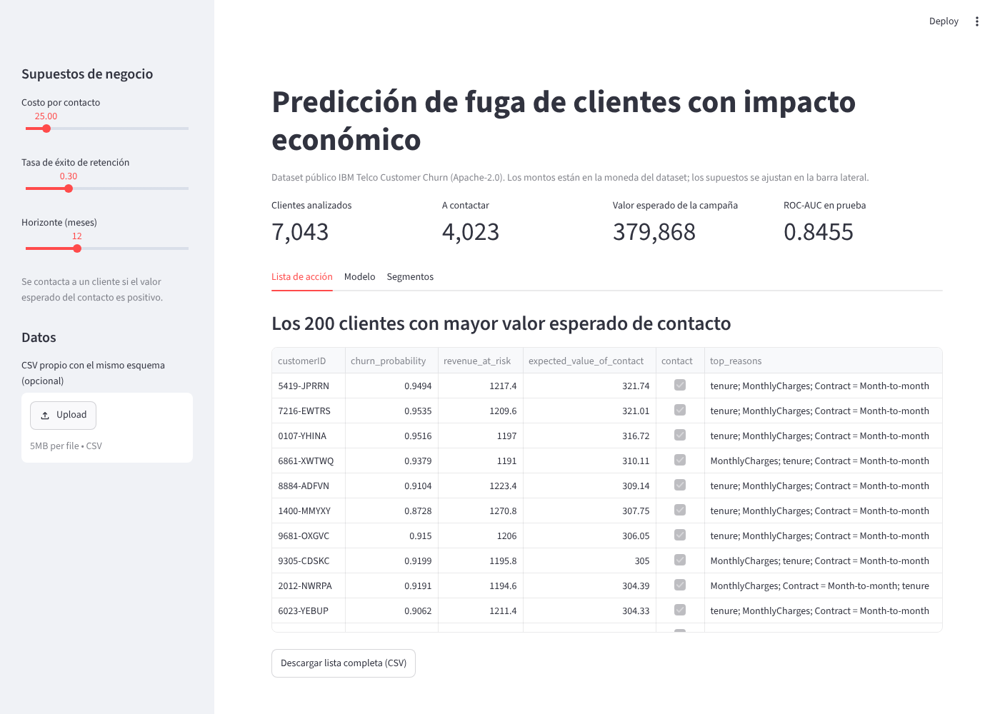
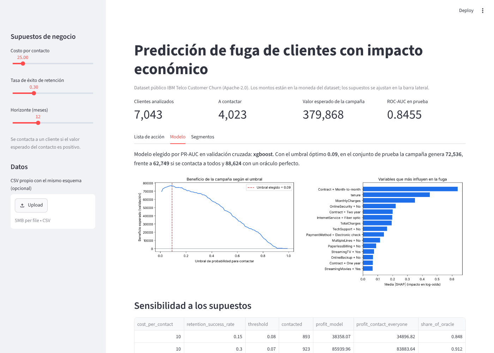

# Telco churn retention: who to call, and why it pays

[](https://github.com/luisk217/luisk217-telco-churn-retention/actions/workflows/ci.yml)


🇪🇸 [Leer en español](README.es.md)

Telecom companies lose a quarter of their customers a year, and retention teams
can't call everyone. This project predicts **which customers are about to leave,
explains why, and decides who to contact by maximizing expected profit**, not
accuracy.



## Results (held-out test set, 1,409 customers)

| Strategy | Customers contacted | Churners reached | Campaign profit* |
|---|---:|---:|---:|
| No campaign | 0 | 0 | 0 |
| Contact everyone | 1,409 | 374 / 374 | 62,749 |
| Model, default 0.5 threshold | 285 | 193 / 374 | 45,721 |
| **Model, profit-optimal threshold (0.09)** | **866** | **355 / 374** | **72,536** |
| Perfect oracle (upper bound) | 374 | 374 / 374 | 88,624 |

\*Assumptions (editable in `config/config.yaml` and the app): contact cost 25,
30 % retention success, 12 months of revenue saved. Monetary units are those of the dataset.

- **+16 % profit vs. contacting everyone, +59 % vs. the usual 0.5 threshold,**
  capturing 82 % of the theoretical maximum.
- ROC-AUC 0.846 · PR-AUC 0.660 · Brier 0.136 (XGBoost, picked over logistic
  regression by 5-fold CV PR-AUC: 0.670 vs 0.667).
- **The model matters more when contacts are expensive.** At a cost of 100 per
  contact, calling everyone loses 42,926 while the model still earns 23,925
  (`reports/sensitivity.csv`).
- Top churn drivers (SHAP): month-to-month contract, short tenure, high monthly
  charges, no online security, fiber optic service. Month-to-month customers
  churn at 42.7 % vs 2.8 % on two-year contracts.



## How it works

```
IBM public CSV ──HTTPS + SHA-256──▶ validate schema ──▶ SQLite (read-only for analysis)
                                                        │
             stratified split 60/20/20 ◀────────────────┘
                 │ train: 5-fold CV picks LogReg vs XGBoost (PR-AUC)
                 │ validation: threshold that maximizes campaign profit
                 │ test: touched once, final report
                 ▼
       model.joblib + manifest (SHA-256) ──▶ SHAP reasons ──▶ ranked action list / Streamlit
```

Key decisions:

- **Profit, not accuracy.** Each contact costs money; each saved churner returns
  `MonthlyCharges × horizon × success rate`. The threshold is chosen on the
  validation set, never on test.
- **No class reweighting.** Imbalance is handled by the economic threshold, so
  probabilities stay calibrated and the per-customer expected value
  (`p × success × value − cost`) is meaningful.
- **SQLite instead of Firebase/Supabase.** 7,043 rows, batch analytics, one
  writer: a file database in Python's standard library is enough, free, needs
  no credentials or network, and adds no attack surface. A hosted database
  (e.g. Supabase's free Postgres tier) only becomes worth it if the app must
  save multi-user state such as call outcomes.

## Run it

```bash
python -m venv .venv && source .venv/bin/activate   # Windows: .venv\Scripts\activate
pip install -r requirements-dev.txt
churn train                                  # download + verify data, train, write reports/
churn score my_customers.csv action_list.csv # score any CSV with the same schema
streamlit run app/streamlit_app.py           # interactive demo
pytest                                       # 40 tests, ~97 % coverage
```

## Project layout

```
config/config.yaml   data source, hash, split and business assumptions
src/churn/           config, data, db, modeling, economics, explain, artifacts, io, pipeline, cli
app/                 Streamlit demo
tests/               unit + end-to-end tests on synthetic data (no network)
reports/             metrics.json, profit curve, SHAP importance, sensitivity table
data/README.md       data card: source, license, format, checksum
SECURITY.md          threat model and controls
```

## Data, libraries and their licenses

| Component | Used for | License |
|---|---|---|
| [IBM Telco Customer Churn](https://github.com/IBM/telco-customer-churn-on-icp4d) | Dataset (CSV, UTF-8) | Apache-2.0 |
| pandas, NumPy, scikit-learn | Data and ML | BSD-3-Clause |
| XGBoost | Gradient boosting | Apache-2.0 |
| SHAP | Explanations | MIT |
| Streamlit | Demo app | Apache-2.0 |
| Matplotlib | Charts | Matplotlib (PSF-style, BSD-compatible) |
| PyYAML, joblib | Config, model files | MIT, BSD-3-Clause |
| SQLite | Storage | Public domain |
| Ruff, pytest, Bandit, pip-audit | Quality and security | MIT, MIT, Apache-2.0, Apache-2.0 |

All are free and open source. See `data/README.md` for the data card.

## Security

Verified downloads, safe YAML, allow-listed SQL with read-only connections,
hash-checked model loading, upload limits and CSV-injection protection, plus
Ruff security rules, Bandit and pip-audit in CI. Details in [SECURITY.md](SECURITY.md).

## Limitations (honest)

- One static snapshot: no time-based validation, so real performance on next
  month's customers is unknown.
- Business assumptions are illustrative; the sensitivity table shows how
  conclusions change with them.
- The retention effect is assumed, not measured. In production this should be
  validated with an A/B test (contacted vs. control group).
- Fictional IBM data; a real deployment would need the company's own data and
  privacy review (Colombia: Ley 1581 de 2012).

## Next steps

- Uplift modeling (who changes behavior when contacted, not just who leaves).
- Probability calibration check (reliability curve) and MLflow experiment tracking.
- Deploy the demo to Streamlit Community Cloud.

## Author

Luis Carlos Hernández Urrego · [LinkedIn](https://www.linkedin.com/in/luis-carlos-hernandez-urrego/) · [GitHub](https://github.com/luisk217)

Built from three years in telecom customer operations (Tigo, Emtelco), where
deciding who to call before they cancel was the daily job.
